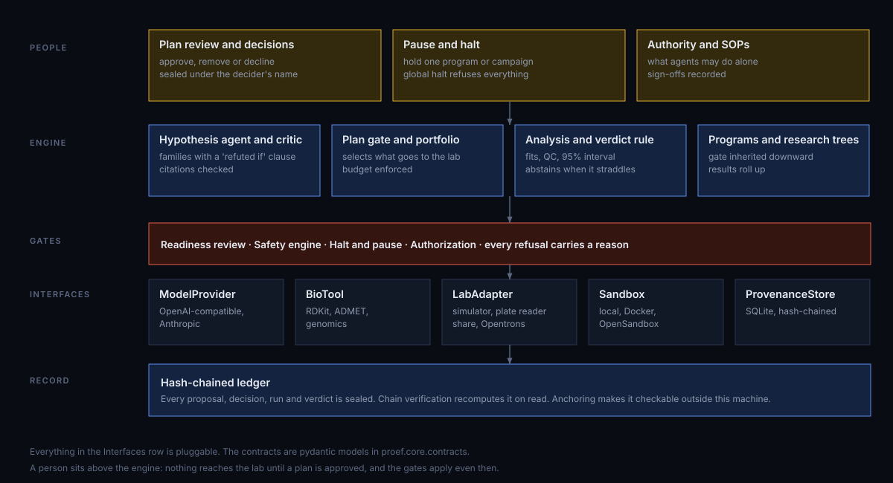

# Architecture

Proef is a campaign engine with five pluggable interfaces, a set of gates that sit in front of every lab action, and one
hash-chained ledger. A person is above the engine: nothing reaches the lab until a plan is approved, and the gates apply
even then.

## Layers

| Layer | What it holds | Where it lives |
|---|---|---|
| People | plan review and decisions, pause and halt, authority and SOP sign-offs | `src/proef/api/v1/inbox.py`, `pauses.py`, `governance.py` · the web workbench in `web/src/` |
| Engine | hypothesis agent and critic, plan gate and portfolio, analysis and verdict rule, programs and research trees | `hypothesis_agent.py`, `critic.py`, `plan.py`, `autoloop.py`, `watch.py`, `core/hypothesis.py`, `program.py`, `problem_tree.py` |
| Gates | readiness review, safety engine, halt and pause, authorization | `readiness.py`, `core/safety.py`, `governance.py` |
| Interfaces | `ModelProvider`, `BioTool`, `LabAdapter`, `Sandbox`, `ProvenanceStore` | `core/interfaces.py`, contracts in `core/contracts/`, adapters in `adapters/` |
| Record | hash-chained ledger, anchoring, wizard registry | `adapters/store/sqlite.py`, `anchor.py`, `wizard_store.py`, `wizard_chain.py` |

## Engine

- **Hypothesis agent** proposes families of hypotheses from the problem. Each has a mechanism, a "refuted if" clause, a
  confidence and a checked citation. It is shown what the lab already ruled out (`flywheel.py`).
- **Critic** reads the plan before the person does and raises concerns. It is advisory and cannot change or approve anything.
- **Plan gate** (`plan.py`, `autoloop._plan_gate`) builds the plan, warns on problems such as one compound under two
  families, and waits for a person. The approval is sealed, and it covers that plan's own lab submissions.
- **Campaign loop** (`autoloop.run_campaign`) runs rounds: select, submit through the gates, read the results, judge,
  and optionally re-plan from the results.
- **Analysis** (`watch.py`, `fitting.py`, `analysis_profiles/`) fits curves or summarizes measurements with a 95% interval.
- **Verdict rule** (`core/hypothesis.py`) compares the interval with the gate registered before any data. An interval that
  straddles the gate abstains, and so does a QC failure.
- **Programs and trees** (`program.py`, `problem_tree.py`) hold the gate and limits, split a question into sub-problems,
  flow the lab-run budget down by priority and roll the leaf verdicts up.

## Gates

Four checks sit between an approved plan and a lab run. Any of them can stop the run, and each stop records its reason.

1. **Readiness review** blocks an experiment whose result would be uninterpretable (missing denominator or controls).
2. **Safety engine** applies the hard policy: reagents, biosafety level, toxicophores, dual-use text.
3. **Halt and pause.** A global halt refuses. A paused program or campaign holds submissions and resumes later.
4. **Authorization** decides what agents may do alone and checks SOP sign-offs.

The gates are code the agent cannot reach. `LabGateway` in `core/safety.py` is the only path to a lab adapter.

## Interfaces

| Interface | Adapters today |
|---|---|
| `ModelProvider` | OpenAI-compatible (OpenAI, Ollama, vLLM), Anthropic |
| `BioTool` | RDKit descriptors, ADMET, genomics scoring |
| `LabAdapter` | simulator, imaging, recording and replay, plate reader share, Opentrons |
| `Sandbox` | local, Docker, OpenSandbox, AgentENV |
| `ProvenanceStore` | SQLite |

Adapters are opt-in and interchangeable. The pydantic models in `core/contracts` are the source of truth.

## Record

Every proposal, decision, run and verdict is a record in a hash-chained SQLite ledger. Engine triggers refuse edits, and
chain verification recomputes the hashes on read. `proef anchor` publishes a Merkle root so the chain is checkable outside
the machine. `proef prove <problem-id>` renders the whole chain as an audit.

## Design principles

1. **Contract-first.** Five schemas couple the platform, nothing else.
2. **Hardware behind an interface.** The simulator is a drop-in `LabAdapter` peer.
3. **Reading a verdict is as sacred as computing it.** Verdicts are driven by the recorded payload.
4. **Provenance is immutable.** Decisions and results are sealed before anything is judged.
5. **Safety is not bypassable.** The gates are in the physical-action path.

See [`flows.md`](flows.md) for the sequences and [`../README.md`](../README.md) for the product overview.
