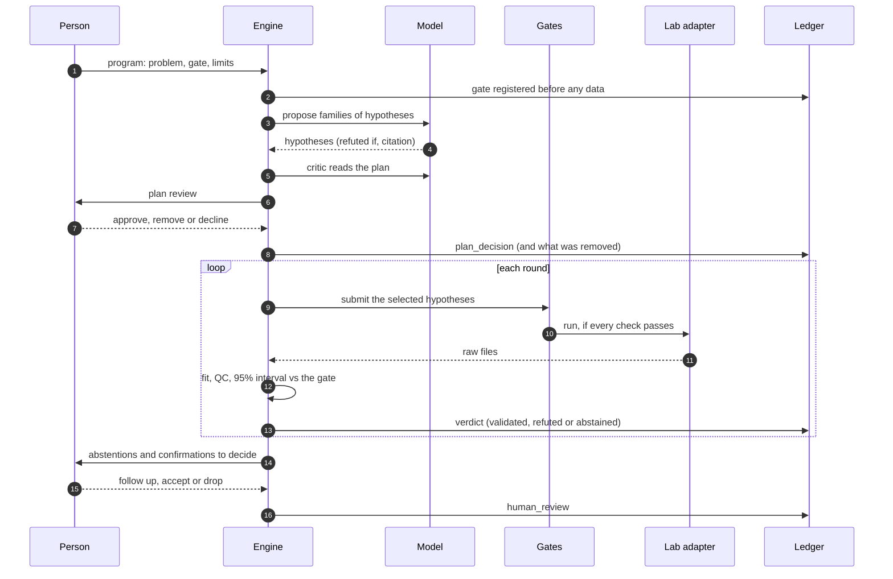
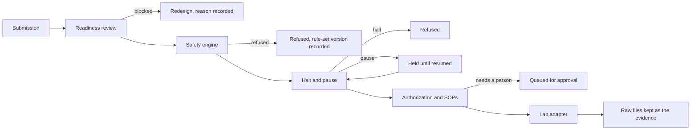
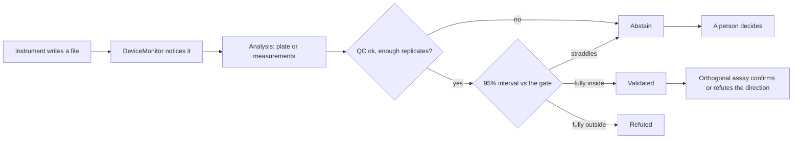
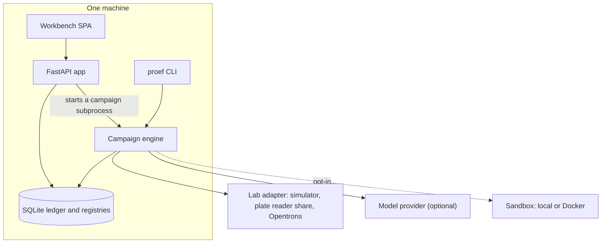

# Flows

## 1. A campaign, with the people in it

With **Re-plan after each round** on, the engine asks the model for new hypotheses from the results and sends them to
the person the same way before the next round.

## 2. Between a plan and a lab run

A plan approval covers that plan's own submissions (`covered_by_plan`). The safety engine still checks every one.

## 3. From a device export to a verdict

## 4. Where it runs

